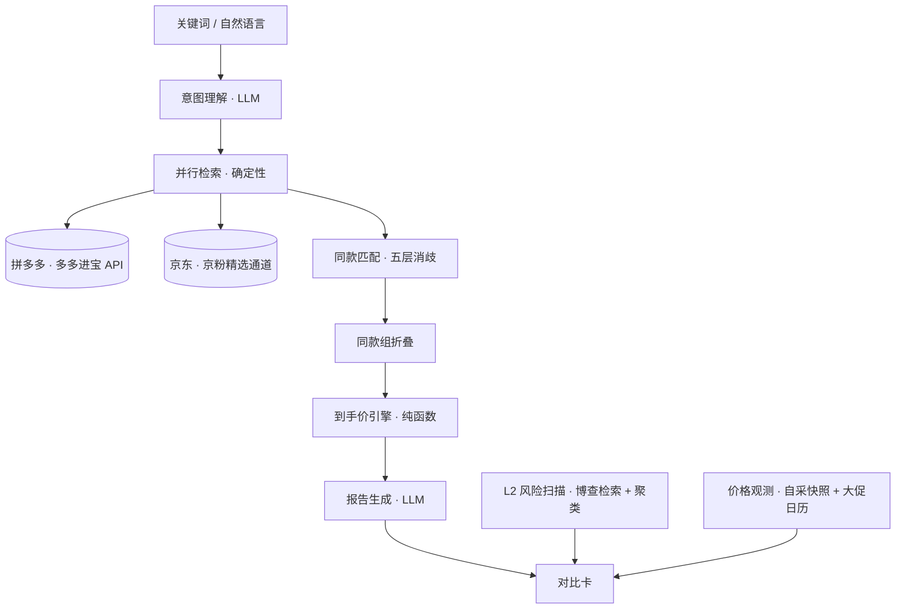

# 真价雷达 PriceRadar

跨平台**到手价决策 Agent**：输入关键词或一句话 → 多平台官方 API 检索 → 同款匹配消歧 → 确定性到手价引擎 → 对比卡 + 风险扫描 + 价格观测。

> 不是又一个比价工具：
> **钱不由 LLM 算**（到手价引擎为纯函数）｜ **口径诚实**（公开优惠测算、样本不足不出结论、缺失即标注）｜ 数据全走官方联盟 API（不碰爬虫红线）

## 架构



## 能力清单

| 模块 | 说明 |
|---|---|
| 到手价引擎 | 门槛判定 / 最优券组合（互斥约束穷举）/ 每满减与阶梯满减 / 逐项公式与拒因；Decimal 精确到分，全部单测覆盖 |
| 同款匹配 | 配件过滤 → 品牌/型号/容量/代际硬规则 → 相似度 sanity → A/B/C 分档；同款组折叠（"￥99 · 同款 ×5 家店铺"） |
| Agent 管线 | 确定性管线 + 两个 LLM 节点（查询理解 / 报告导语），LLM 失败自动降级不阻塞 |
| L2 风险扫描 | 品类风险词 × 博查检索 → 跨查询词聚类（LLM）→ 覆盖声明；证据不足时如实说"未发现" |
| 价格观测 | 自采快照的时机分位 + "先涨后降"检测 + 大促日历；样本 <14 天只显示"数据积累中" |
| 识图与券补录 | Qwen-VL 商品图识别（一键比价）/ 券截图识别 → **用户确认** → 并入到手价重算（明细含 [补录] 标记） |
| Web 界面 | 单页：搜索 / 风险开关 / 快照采集 / 降价提醒 / **关注面板**（观测天数 + 时机判断 + sparkline）/ `启动真价雷达.bat` 一键拉起 |
| 评测护栏 | 218 对构造评测集 100%；真实标注集工具链（候选收集 + 交互标注） |
| MCP Server | 比价 / 风险扫描 / 价格观测三工具开放给 Claude · Cursor（stdio，mcp SDK 2.x） |
| 可观测 | 每次查询记录 trace（节点耗时 / API 计数 / 估算成本），落盘 `data/traces/` |

## 快速开始

```bash
python -m venv .venv
.venv/Scripts/pip install -e ".[dev]"     # Windows；Linux/macOS 用 .venv/bin/pip
pytest                                    # 测试套件（147 绿）
双击「启动真价雷达.bat」                    # Windows 一键启动（自动打开浏览器）
python -m priceradar.agent.pipeline "帮我看看QCY N20哪里买划算"   # 端到端 CLI（--risk / --no-llm 可选）
python -m priceradar.jobs.snapshot        # 价格快照采集（幂等，可每日复跑）
python -m evaluation.run_eval             # 同款匹配评测（报告写 evaluation/results_v1.md）
python -m priceradar.mcp_server           # MCP Server（stdio；Claude/Cursor 配置见 docs/next-steps.md）
```

需要 `.env`（模板见 `.env.example`）：拼多多开放平台 / 京东联盟 / 博查 / DeepSeek 凭证。账号申请指引：[docs/accounts-onboarding.md](./docs/accounts-onboarding.md)。

## 同款匹配评测

- **构造评测集 v1：218 对**（真实标题种子 × 确定性变换，ground truth by construction；方法论与局限见 `evaluation/build_dataset.py` 文件头）——总体准确率 100%、A 档 Precision / Recall 100%（回归护栏 ≥85%）
- **真实标注集 v2**：`python -m evaluation.collect_candidates` 收集真实跨平台候选 → `python -m evaluation.label_tool` 交互标注 → 指标并入评测报告
- 评测循环曾实际发现并修复：1 个匹配器 bug（全角标题型号提取失效）+ 2 个构造 bug —— 护栏会持续拦截回归

## 设计原则

- **钱不由 LLM 算**：到手价、匹配、时机判断全部为确定性代码，LLM 只做"理解"与"表达"
- **降级不阻塞**：每个外部依赖（京东接口 / 搜索 API / LLM）失败都有显式降级路径，且如实标注
- **诚实优先**：公开优惠口径 + "以结算页为准"；观测天数如实计数；证据不足时明说而非编造
- **合规数据层**：官方联盟 API / 授权服务；返佣不计入到手价（见 [PRD §6](./PRD.md)）

## 路线图

- ✅ M0：到手价引擎 / 双平台数据源 / 同款匹配 / Agent 管线
- ✅ M1 核心件：Web 界面 / 评测集 v1 / 快照采集 / 风险扫描 / 价格观测 / 大促日历 / MCP Server
- ⏳ 进行中：真实标注集 v2（标注中）；识图模块已就绪待凭证（`python scripts/check_qwen_vl.py 商品图.jpg`，需 DASHSCOPE_API_KEY）
- 详单与每日纪律：[docs/next-steps.md](./docs/next-steps.md)

## 文档

- [PRD v0.2](./PRD.md)（现行）｜ [可行性评审](./docs/feasibility-review.md) ｜ [v0.1 归档](./docs/prd-v0.1.md)
- [京东接口实测记录](./docs/jd-api-findings.md) ｜ [账号接入指引](./docs/accounts-onboarding.md) ｜ [开工清单](./docs/next-steps.md) ｜ [部署 Runbook](./docs/deployment-runbook.md)
