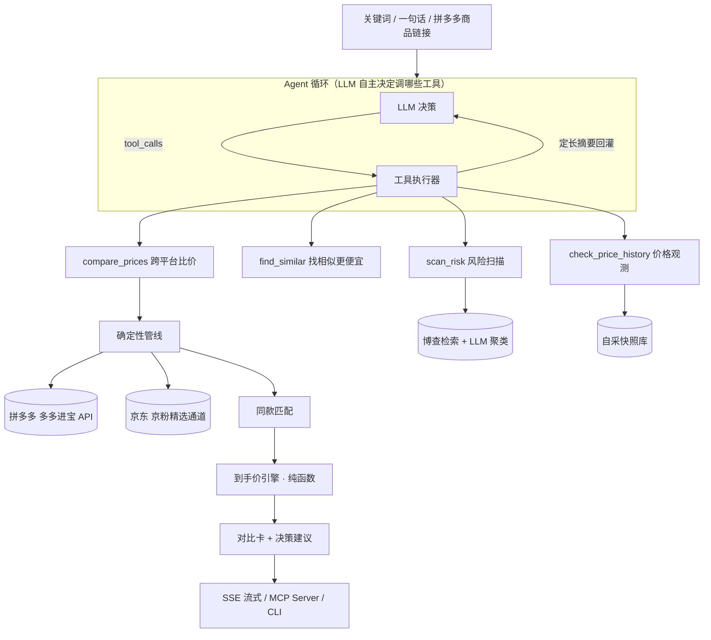

# 真价雷达 PriceRadar

跨平台**到手价决策 Agent**：输入关键词、一句话或拼多多商品链接 → LLM 自主决定调用哪些工具 → 多平台官方 API 检索 → 同款消歧 → 确定性到手价引擎 → 对比卡 + 风险扫描 + 价格观测。

> **不是又一个比价工具，也不是又一个 LLM 套壳：**
>
> **钱不由 LLM 算**（到手价引擎是纯函数，LLM 只负责决策与表达）｜ **确定性内核 + Agent 外壳**（LLM 决定调什么工具，工具负责给事实）｜ **口径诚实**（公开优惠测算、样本不足不出结论、拿不到就说拿不到）｜ **数据全走官方联盟 API**（不碰爬虫红线）

## 架构



一轮真实的多意图查询（`agent.loop`）：

```
[第 1 轮] 我来同时查一下比价和口碑风险。
  ✓ compare_prices {"query": "QCY N20 降噪耳机"}      ← 模型自己决定
  ✓ scan_risk      {"product": "QCY N20"}             ← 并且并行发起
【最终答复】……（并用中文如实转达「风险扫描未获有效信息」）
[trace] 耗时 5020 ms｜token 入 2953/出 288（缓存命中 87%）｜估算成本 ￥0.0016
```

## 能力清单

| 模块 | 说明 |
|---|---|
| **Agent 循环** | LLM 自主选工具、决定调几次、何时停。硬约束：轮次上限 / 单轮调用上限 / 单请求外部调用总预算 / 上下文预算；**按工具定重试策略**（pdd 系不重试——客户端内部已重试 3 次，再试会触发已知的账号限流）；单请求内结果 memo；触顶或 LLM 失败**降级回确定性管线且不重跑外部调用** |
| **流式输出** | `GET /api/agent/stream`（SSE）：`step` / `tool` / `notice` / `final` / `error` 事件，后台线程 + 队列实现边跑边推（实测首帧 1.2s 到达，而非等 10.8s 一次性涌出）；心跳保活；nginx 部署所需的 `X-Accel-Buffering: no` |
| **多轮会话** | 结构化槽位（关键词 / 商品 / goods_sign）+ 最近若干**完整轮**；裁剪**只允许整轮丢弃**（半轮会让 `tool_call_id` 配不上对，服务端直接 400）；固定前缀前置以命中 prompt 缓存 |
| 到手价引擎 | 门槛判定 / 最优券组合（互斥约束穷举）/ 每满减与阶梯满减 / 逐项公式与拒因明细；Decimal 精确到分，全部单测覆盖 |
| 同款匹配 | 配件过滤 → 品牌 / 型号 / 容量 / 代际硬规则 → 相似度 sanity → A/B/C 分档；同款组折叠（「￥99 · 同款 ×5 家店铺」） |
| L2 风险扫描 | 风险词 × 博查检索 → 跨查询聚类（LLM）→ 覆盖声明；证据不足时如实说"未发现"，绝不编造 |
| 价格观测 | 自采快照的时机分位 + "先涨后降"检测 + 大促日历；样本 <14 天只显示"数据积累中" |
| 识图与券补录 | Qwen-VL 商品图识别（一键比价）/ 券截图识别 → **用户确认** → 并入到手价重算（明细含 `[补录]` 标记） |
| MCP Server | 比价 / 风险扫描 / 价格观测三工具开放给 Claude · Cursor（stdio，mcp SDK 2.x） |
| Web 界面 | 单页零依赖：Agent 模式开关 + 实时进度面板 / 决策卡 / 筛选 / 降价提醒 / 关注面板（sparkline）/ 一键盯降价 |
| 可观测 | 每次查询落 trace（节点耗时 / API 计数 / **真实 token 分项与缓存命中率** / 成本）；LLM 成本按 token 与官方单价计算，拿不到 token 时**如实标注"这是按次粗估"** |

## 评测

三份报告都在 `evaluation/`，**三种读法各不相同**：

| 报告 | 测什么 | 结果 |
|---|---|---|
| [同款匹配 `results_v1.md`](evaluation/results_v1.md) | 218 对构造集（确定性变换 + 人工种子） | 准确率 100%，A 档 Precision / Recall 100% |
| [Agent 行为 `results_agent.md`](evaluation/results_agent.md) | 8 个场景的**真实模型响应录制 + 离线回放**，含 2 个真实失败路径 | 工具选择 8/8、降级率 0%、硬失败后不重复试探 100%、缓存命中率 79.9% |
| [向量层 `results_vector.md`](evaluation/results_vector.md) | 文本向量能否用于同款判定 | **否——负结果，故不进判定路径** |

**关于「100%」的诚实说明**：构造集是确定性变换生成的，不代表真实分布；真实标注集（`evaluation/label_tool.py`）仍需人工标注。Agent 评测的 8 个场景同样由人工撰写，样本很小——真正说明问题的是那几条**行为**：无多余调用、链条依赖被正确解析（找同款走了 2 轮）、以及两个**真实失败路径**（类目空洞 / 非原始链接）里模型都如实说明了原因、没有徒劳重试。

**向量层为什么被否掉**：纯向量最优阈值下准确率 70.2%（规则同一集合 100%），且**换型号的负例余弦（最高 0.96）高于堆了促销词的真同款（最低 0.91）**——分布重叠。`N20` 与 `N60` 在语义空间里几乎是一回事，在商品世界里是两件东西。测试里有护栏钉住 `matcher.py` 不依赖向量。

## 快速开始

```bash
python -m venv .venv
.venv/Scripts/pip install -e ".[dev]"     # Windows；Linux/macOS 用 .venv/bin/pip
pytest                                    # 500 个测试

python -m priceradar.service.api          # Web → http://127.0.0.1:8000（自动开浏览器）
                                          # Windows 也可双击「启动真价雷达.bat」
python -m priceradar.agent.loop "帮我看看QCY N20哪里买划算，顺便有没有踩坑的"
python -m priceradar.agent.pipeline "QCY N20 哪里买划算"          # 固定管线（对照用）
python -m evaluation.run_eval             # 同款匹配评测
python -m evaluation.agent_eval           # Agent 行为评测（离线回放，零花费）
python -m priceradar.mcp_server           # MCP Server（stdio）
```

需要 `.env`（模板见 `.env.example`）：拼多多开放平台 / 京东联盟 / 博查 / DeepSeek / DashScope 凭证。账号申请指引见 [docs/accounts-onboarding.md](docs/accounts-onboarding.md)。

MCP 接入 Claude Code：

```bash
claude mcp add priceradar -- <项目路径>/.venv/Scripts/python.exe -m priceradar.mcp_server
```

## 设计取舍

- **钱不由 LLM 算** —— 到手价、同款判定、时机判断全部是确定性代码，LLM 只做"理解"与"表达"。模型给出的金额一律视为不可信。
- **降级不阻塞，且如实标注** —— 每个外部依赖（京东接口 / 搜索 API / LLM / 向量）失败都有显式降级路径，并在结果里写明退到了哪一步；不静默、不假装。
- **不做综合评分** —— 好评率必须配样本量一起看（Wilson 置信区间下界），"3 条评论的 100% 好评"撑不起任何结论。PRD 明令禁止伪科学评分。
- **不上编排框架** —— 这里是「一条循环 + 工具调用」，图框架的价值（条件边 / checkpoint / 人机协同）用不满，引入即过度设计；自研循环每一行都能讲清，也便于把失败语义做精确。
- **不硬塞 RAG** —— 知识源是**结构化实时价格**而非文档；检索增强在这里的正确形态是结构化过滤 + 平台原生相似推荐。风险扫描本身就是 Retrieval-Augmented。
- **合规数据层** —— 官方联盟 API / 授权服务；返佣不计入到手价（详见 [PRD §6](PRD.md)）。

## 已知限制（写在明面上）

- **拼多多有类目空洞**：手机、平板、显示器、电视、键盘、鼠标等整机与外设类目返回空（平台侧屏蔽，不是故障）。日用品与配件类正常。
- **跨平台同款命中率仅约 11%**（18 个查询实测）：京东侧能搜到商品，但"同款可比"只有约 1/10——京粉频道池是"平台在推的商品"而非全量库。**京东定位是"偶尔捡漏"的增值项，不承诺全平台比价。**
- **拼多多账号限流**：判据是「调用量 vs 出单量」，本项目账号天然不出单，高频调试会触发。已按工具定重试策略以尽量少打接口。
- **价格观测基于自采快照**，非平台全历史；样本不足时不出时机结论。
- **拼多多网页端不显示价格**（平台限制），关注面板里的链接仅供跳转购买，到手价以本工具测算为准。

## 路线图

- ✅ M0：到手价引擎 / 双平台数据源 / 同款匹配 / Agent 管线
- ✅ M1：Web 界面 / 评测集 v1 / 快照采集 / 风险扫描 / 价格观测 / 大促日历 / MCP Server
- ✅ M2：**Agent 化**——工具调用循环 / SSE 流式 / 多轮会话 / 行为评测 / 真实 token 计量 / 向量层测量（负结果）
- ⏳ 下一步：真实标注集（人工）/ 服务器部署 / 平台推荐集去噪的 precision@k 测量

详单与每日纪律见 [docs/next-steps.md](docs/next-steps.md)；Agent 化的完整设计与**被推翻的初版**见 [docs/agent-upgrade-plan.md](docs/agent-upgrade-plan.md)。

## 文档

- [PRD v0.2](PRD.md)（现行）｜ [可行性评审](docs/feasibility-review.md) ｜ [v0.1 归档](docs/prd-v0.1.md)
- 接口实测：[拼多多](docs/pdd-api-findings.md) ｜ [京东](docs/jd-api-findings.md) ｜ [账号接入](docs/accounts-onboarding.md)
- 工程：[Agent 化改造计划](docs/agent-upgrade-plan.md) ｜ [开工清单](docs/next-steps.md) ｜ [部署 Runbook](docs/deployment-runbook.md)
